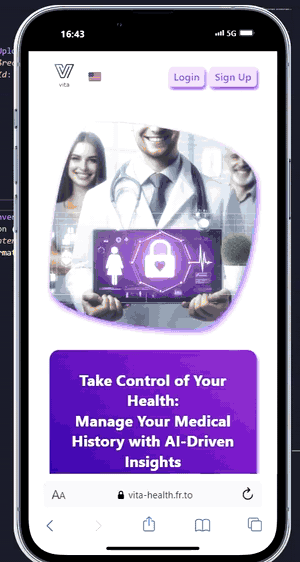
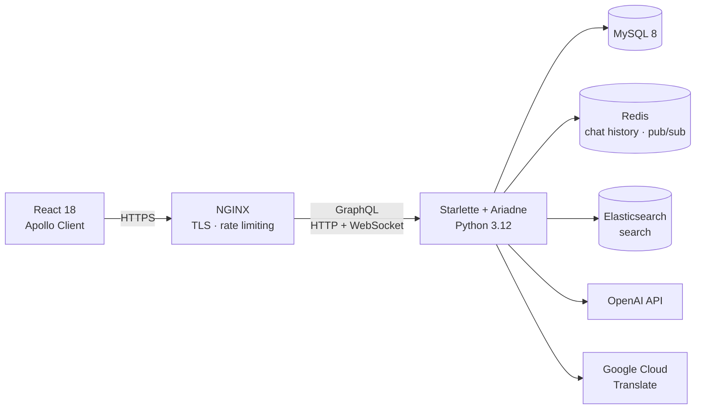
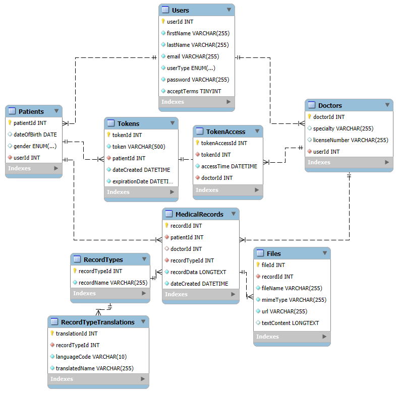

<p align="center">
  
</p>

<h1 align="center">Vita</h1>

<p align="center">
  <em>Your medical history in one place, shared with doctors through expiring access tokens and explained by an AI assistant.</em>
</p>

<p align="center">
  
  
  
  
  
  
  
  
</p>

<p align="center">
  <a href="docs/demo.mp4"></a>
  <br>
  <a href="docs/demo.mp4"><b>▶ Watch the 48-second walkthrough</b></a>
</p>

https://github.com/user-attachments/assets/23a31237-5a6d-42eb-8753-69c7d9af9b51

---

## What it does

- **Patients own their data.** Create an account, add health records with a rich-text editor, upload exam files and browse the full history.
- **Time-boxed sharing with doctors.** A patient generates an access token with an expiration date and gives it to a doctor. The doctor can read the history (and add recommendations) only until the token expires. The patient sees who accessed the data and can deactivate a token at any time.
- **AI health assistant.** Questions are answered by OpenAI (`gpt-4o-mini`) using only the patient's own records, and the answer streams to the UI over GraphQL subscriptions.
- **Search that understands exams.** Text is extracted from uploaded PDFs and images (PyMuPDF, with Tesseract OCR as fallback) and indexed in Elasticsearch together with the records, with n-gram matching and highlighted results.
- **Bilingual.** The interface is available in English and Brazilian Portuguese, and record categories are translated automatically with Google Cloud Translate.
- **Account recovery.** Password reset by email.

> The assistant's answers are informational and are not medical advice.

## Architecture



- **Schema-first GraphQL.** [`server/schema.graphql`](server/schema.graphql) is the contract between client and server. Queries and mutations go over HTTP, and the assistant's streamed answer uses a `message` subscription over WebSocket (`graphql-ws`).
- **Authentication and authorization.** Passwords are hashed with bcrypt and sessions use JWT. Sharing uses a signed, expiring token generated by the patient, and uploaded files are served only to the patient who owns them or to a doctor holding a valid token.
- **Input handling.** User text and rich-text content are sanitized with `nh3` before being stored or sent to the model.
- **Conversation state.** Chat history lives in Redis. For patients it expires after one hour, and for doctors it expires together with the patient's access token.
- **Database.** Schema and stored procedures in [`database/vita_health.sql`](database/vita_health.sql).

<details>
<summary><b>Entity-relationship diagram</b></summary>
<br>
<p align="center">
  
</p>
</details>

## Tech stack

| Layer | Technologies |
| :--- | :--- |
| Frontend | React 18, Apollo Client (`graphql-ws`, `apollo-upload-client`), React Router, PrimeReact, Formik + Yup, TinyMCE, Framer Motion |
| Backend | Python 3.12, Starlette, Ariadne, PyJWT, bcrypt, nh3, PyMuPDF, pytesseract |
| Data | MySQL 8, Redis, Elasticsearch 8.15 |
| External services | OpenAI API, Google Cloud Translate, SMTP (password reset) |
| Infrastructure | Docker Compose, NGINX with Let's Encrypt TLS, GitHub Actions, Google Cloud VM |

## Repository layout

```text
client/                  React app (pages, components, GraphQL operations, providers, i18n)
server/
├── schema.graphql       GraphQL schema
├── resolver.py          Resolvers (queries, mutations, subscription)
├── auth.py              JWT authentication and request context
├── routes.py            Authorized file serving
├── db/                  MySQL, Redis, Elasticsearch and OpenAI access
└── emails/              Password-reset email templates
database/                MySQL schema and ER diagram
docker-compose.dev.yml   Local development stack
docker-compose.prod.yml  Production stack (adds NGINX)
nginx.conf               HTTPS, WebSocket proxy and rate limiting for /graphql/
.github/workflows/       Deploy workflow
```

## Running locally

**Requirements:** Docker with Compose, plus the API keys listed below.

1. Clone the repository:

   ```sh
   git clone https://github.com/TiagoIesbick/vita-health.git
   cd vita-health
   ```

2. Create a `.env` file in the project root:

   ```env
   MYSQL_USER=vita_health
   MYSQL_PASSWORD=<choose a password>
   MYSQL_DATABASE=vita_health
   HOST=database
   PORT=3306
   REDIS_HOST=redis
   REDIS_PORT=6379
   ELASTICSEARCH_HOST=elasticsearch
   ELASTICSEARCH_PORT=9200

   # JWT signing key. Generate your own: openssl rand -hex 32
   SECRET=<random string>

   TINYMCE_API_KEY=<free key from https://www.tiny.cloud/>
   OPENAI_API_KEY=<key from https://platform.openai.com/api-keys>

   # Google Cloud Translate service-account key (see step 3)
   GOOGLE_APPLICATION_CREDENTIALS=/server/config/vita-health-432601-d5ccd599a1ab.json

   # Password-reset emails
   SMTP_SERVER=smtp.gmail.com
   SMTP_PORT=587
   EMAIL_SENDER=<your gmail address>
   APP_PASSWORD=<Google app password>
   ```

3. Save your Google Cloud service-account JSON in the project root as `vita-health-432601-d5ccd599a1ab.json`. That is the file name `docker-compose.dev.yml` mounts, so change the volume mapping if you prefer another name.

4. Create the uploads folder and start the stack:

   ```sh
   mkdir -p server/uploads
   docker compose -f docker-compose.dev.yml up -d --build
   ```

5. Open the app at <http://localhost:3000>. The GraphQL endpoint is <http://localhost:8000/graphql/>.

### Try it end to end

1. Create a **patient** account, then add a health record under **Add Health Data** (attach a PDF or image if you like).
2. Open **History**, pick a record, and ask the assistant a question about it.
3. In **Token**, set an expiration date, generate a token and copy it.
4. Log out, create a **healthcare professional** account, paste the token under **Token**, and open the patient's history.
5. Back in the patient account, check **Active Tokens** to see who accessed the data, or deactivate the token.

## Deployment

Pushing to the `production` branch runs [`deploy.yml`](.github/workflows/deploy.yml). The workflow copies the project to a Google Cloud VM over SSH, writes `.env` from GitHub Actions secrets and rebuilds the stack with `docker-compose.prod.yml`, where NGINX terminates TLS and proxies `/graphql/` to the API.

## Status and roadmap

Working today: both user roles, records and file uploads, token-based sharing with access history, the streaming assistant, search and the English/Portuguese interface.

Planned:

- [ ] Edit and delete health records
- [ ] Automated tests (the client only has the default Create React App test so far)
- [ ] Type safety on client and server
- [ ] Pattern recognition on image exams
- [ ] Compression for stored files
- [ ] Accessibility improvements

## Contributing

Issues and pull requests are welcome. Please open an issue first for larger changes.

## License

Released under the [MIT License](LICENSE).

---

<p align="center">
  Built by <a href="https://www.linkedin.com/in/tiago-iesbick">Tiago Iesbick</a>
</p>
